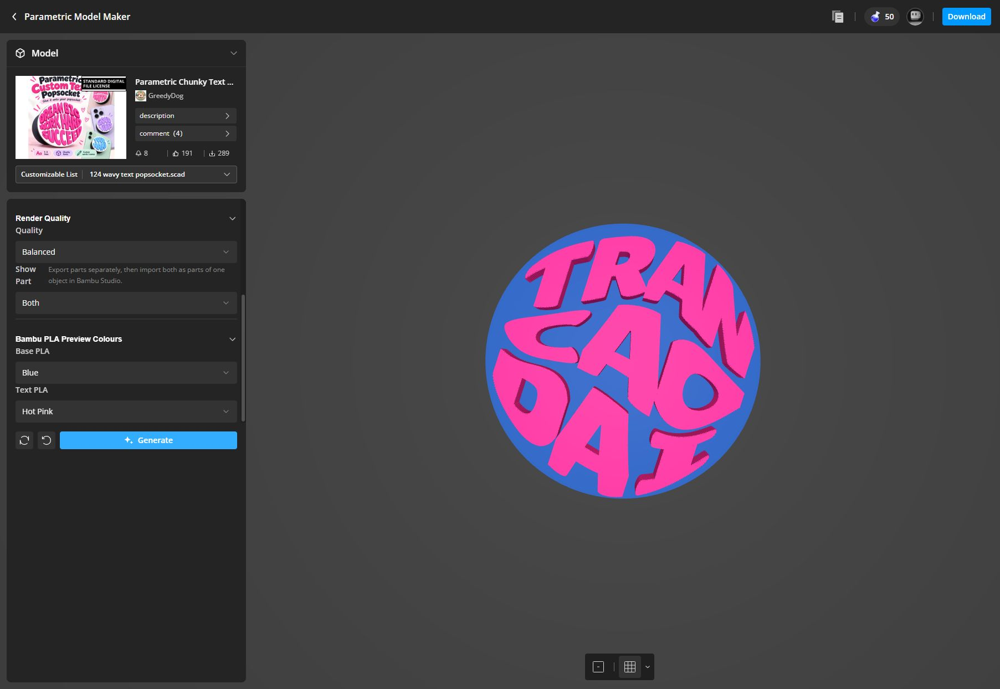

# Khảo sát MakerWorld Parametric Model Maker

Ngày quan sát: **16/10/2026**. Khảo sát trực tiếp trên tab MakerWorld đã đăng nhập trong trình duyệt của ChatGPT.

- [Mẫu tham chiếu](https://makerworld.com/en/models/3417257-parametric-chunky-text-pop-socket-phone-grip-name)
- [Trình tùy chỉnh của mẫu](https://makerworld.com/en/makerlab/parametricModelMaker?designId=3417257&modelName=124+wavy+text+popsocket.scad&protected=true)
- [Trang chủ công cụ](https://makerworld.com/en/makerlab/parametricModelMaker?pageType=home)

## Phạm vi và kết quả

Đã mở toàn bộ **7 nhóm, 27 tham số** của `124 wavy text popsocket.scad`, đọc các menu lựa chọn và giới hạn của 16 thanh trượt. Ngoài mẫu này, đã xem trang chủ, Creator Portal, trình sửa SCAD trống và code mẫu chính thức để khảo sát các loại điều khiển mà công cụ hỗ trợ.

Mẫu của GreedyDog tạo **mặt trang trí tròn gắn lên phone grip**. Mô tả của tác giả xác nhận cơ cấu co giãn/adapter là mẫu riêng. Vì vậy, triển khai mẫu này không đồng nghĩa đã có toàn bộ cơ cấu popsocket.

Các giá trị trong bảng dưới là cấu hình trên phiên người dùng đang mở. Chỉ đường kính 40 mm, nền dày 1 mm và chữ cao 4 mm được mô tả của tác giả xác nhận là mặc định. Những giá trị khác không được coi là mặc định gốc khi chưa thử Reset.

## 1. Nội dung và phông chữ: 5 tham số

| Nhóm | Điều khiển | Giá trị quan sát / lựa chọn | Vai trò |
|---|---|---|---|
| Words | Line 1 | TRAN | Nội dung dòng thứ nhất |
| Words | Line 2 | CAO | Nội dung dòng thứ hai |
| Words | Line 3 | DAI | Nội dung dòng thứ ba |
| Words | Layout | 1 Line, 2 Lines, 3 Lines; đang chọn 3 Lines | Số dòng được sử dụng |
| Chunky Font Picker | Font Choice | Lilita One | Chọn phông cho cả bố cục |

Danh sách phông của riêng mẫu: **Lilita One, Cherry Bomb One, Luckiest Guy, Titan One, Bagel Fat One, Bevan, Ultra**. Danh sách này khác thư viện phông tổng quát trong Creator Portal.

## 2. Căn chữ trong vòng tròn: 9 tham số

| Điều khiển | Giá trị | Khoảng thanh trượt | Bước | Ý nghĩa theo giao diện |
|---|---:|---:|---:|---|
| Base Diameter | 40 | 30–80 | 1 | Đường kính mặt tròn, mm |
| Side Margin | 1.50 | 0.5–4 | 0.25 | Khoảng cách với mép bên |
| Line Spacing | 0.9 | 0–3 | 0.1 | Khoảng cách giữa các dòng |
| Letter Spacing | 0.15 | 0–1.5 | 0.05 | Khoảng cách giữa các ký tự |
| Word Space | 35 | Không có slider | Nút tăng/giảm | Khoảng cách giữa các từ |
| Width Fill | 94 | 70–100 | 1 | Mức lấp đầy theo bề ngang |
| Round Warp | 100 | 0–100 | 5 | Mức biến dạng theo vòng tròn |
| Glyph Width Adjust | 100 | 65–145 | 5 | Điều chỉnh chiều rộng ký tự |
| Glyph Height Adjust | 100 | 70–125 | 5 | Điều chỉnh chiều cao ký tự |

Ngoài Base Diameter, giao diện không ghi rõ đơn vị của các trường này. Không suy diễn các con số thành mm hoặc phần trăm khi chưa xác minh công thức. Word Space có ô nhập và hai nút tăng/giảm; chưa xác định được min/max hay bước từ giao diện.

## 3. Chữ lượn sóng: 5 tham số

| Điều khiển | Giá trị | Khoảng | Bước |
|---|---:|---:|---:|
| Wavy Lines | Bật | Bật/tắt | — |
| Wave Amount | 2.50 | 0–6 | 0.25 |
| Wave Cycles | 1.00 | 0.5–2.5 | 0.25 |
| Wave Phase | 0 | −180–180 | 10 |
| Wave Top Bottom | 40 | 0–100 | 5 |

Các tên điều khiển thể hiện biên độ, chu kỳ, pha và cách phân bố hiệu ứng ở vùng trên/dưới. Công thức biến dạng ký tự chưa được xác minh: mẫu đang ở chế độ bảo vệ và không hiển thị nút Code.

## 4. Chiều dày và mép: 4 tham số

| Điều khiển | Giá trị | Khoảng | Bước | Vai trò |
|---|---:|---:|---:|---|
| Base Depth | 1.0 | 0–3 | 0.1 | Độ dày nền |
| Text Height | 4.00 | 1–10 | 0.25 | Chiều cao chữ |
| Text Embed | 0.12 | 0–0.3 | 0.01 | Độ lồng chữ vào nền theo tên tham số |
| Top Edge Round | 0.15 | 0–1.5 | 0.05 | Bo cạnh trên |

Độ lồng và phép bo cần được kiểm tra trên mesh nếu triển khai lại. Chưa có file xuất để xác nhận tọa độ Z, giao nhau giữa các phần, tính kín của mesh hoặc bán kính bo thực tế.

## 5. Chất lượng, phần hiển thị và màu: 4 tham số

| Điều khiển | Lựa chọn | Giá trị quan sát |
|---|---|---|
| Quality | Fast, Balanced, Fine | Balanced |
| Show Part | Both, Base Only, Text Only | Both |
| Base PLA | Bảng 21 màu | White |
| Text PLA | Bảng 21 màu riêng | Hot Pink |

Hai bảng màu có cùng danh sách: White, Black, Red, Orange, Yellow, Green, Blue, Purple, Pink, Hot Pink, Light Pink, Gold, Silver, Gray, Brown, Beige, Cyan, Lime Green, Light Blue, Dark Blue.

**Đã thử thành công:** đổi Base PLA từ White sang Blue, giữ Text PLA là Hot Pink, nhấn Generate. Chỉ nền đổi sang xanh; chữ vẫn hồng. Undo đưa tham số nền về White, nhưng preview vẫn xanh cho tới khi nhấn Generate lần nữa. Sau đó đã khôi phục nền trắng/chữ hồng.

Ghi chú của mẫu hướng dẫn xuất nền và chữ riêng rồi nhập chúng thành các part của cùng một object trong Bambu Studio. Đây là hướng dẫn trên giao diện; kết quả xuất riêng chưa được kiểm chứng.

## 6. Vòng đời chỉnh sửa

| Chức năng | Điều quan sát được |
|---|---|
| Nhóm tham số | Accordion mở/đóng; bảng tùy chỉnh cuộn riêng |
| Nhập giá trị | Ô nhập trực tiếp, slider hoặc nút tăng/giảm tùy loại |
| Generate | Dựng lại mô hình sau khi đổi tham số; nút đổi sang trạng thái đang xử lý |
| Preview cũ | Vẫn hiện khi tham số đã đổi mà chưa dựng lại; cũng giữ lại khi lần dựng mới bị lỗi |
| Undo | Đã xác nhận hoàn tác thay đổi màu nền trong form; cần Generate để đồng bộ preview |
| Reset all parameters | Có nút đặt lại; không thử reset cấu hình của người dùng |
| History | Menu có nhiều mốc thời gian, biểu tượng ngôi sao và bút sửa ở mỗi mục |
| Model | Có thể thu gọn thẻ thông tin; có ảnh, tác giả, mô tả, bình luận và số liệu tương tác |
| Customizable List | Trong model này chỉ có một file SCAD để chọn |

Chưa thử đánh dấu, đổi tên hoặc tải lại một mục History. Không coi các thao tác đó là đã kiểm thử chỉ dựa trên biểu tượng.

## 7. Khung 3D

- Đã kéo chuột để xoay mô hình và nhìn thấy độ nổi của chữ, độ dày nền.
- Thanh dưới có hai lựa chọn hiển thị mặt phẳng/bàn in và menu chọn loại máy. Đã đổi trạng thái hiển thị và thấy bàn in xuất hiện ở góc nhìn nghiêng.
- Danh sách máy quan sát được: A1, A1 mini, A2L, P1S, P2S, X1C, X2D, H2D, H2D Pro, H2C, H2S, P1P, X1E, X1. Đây là danh sách UI tại ngày khảo sát.
- Các biểu tượng viewer không có nhãn truy cập rõ ràng; chưa xác nhận tên chính thức của từng biểu tượng. Chưa kiểm thử pan, phím tắt, cảm ứng hay zoom.

## 8. Xuất file

Luồng đã mở trực tiếp:

1. Download ở thanh trên.
2. Hộp Select Printer: chọn một profile máy; có Cancel/Confirm.
3. Hộp thiết kế sẵn sàng: có thông báo giấy phép, dòng ghi nguồn và nút sao chép.
4. Mũi tên của nút tải mở **Download STL / Download 3MF**.

Đã kiểm tra tới menu định dạng. Nút tải cuối đi kèm việc đồng ý điều kiện giấy phép của mẫu gốc, nên chưa thực hiện bước đó. Chưa có bằng chứng về màu trong 3MF, số object, vị trí các part, đơn vị, tính kín của STL hoặc hoạt động trong slicer. Không lấy việc menu có STL/3MF làm bằng chứng file xuất đúng.

Khi thử Generate với Base Only, trang báo lỗi máy chủ; thử lại một lần vẫn chưa có preview nền riêng. Đã đưa Show Part về Both. Lỗi này không chứng minh thuật toán Base Only sai, vì kết quả bị chặn ở dịch vụ dựng hình.

## 9. Trang chủ và Creator Portal

Trang chủ có tìm kiếm, các cách sắp xếp Trending/Downloads/Newest/Selected, bộ lọc danh mục, lưới khám phá, Recent Customizations với Full History, và Saved Models. Đã đọc các mục này; chưa thay đổi bộ sưu tập hay tài khoản.

Creator Portal có **Open SCAD File** và **Blank SCAD File**. Đã mở file trống trong tab khảo sát riêng, sau đó dùng Sample code chính thức. Giao diện xin xác nhận trước khi thay thế code hiện tại bằng code mẫu.

Trình Code có editor, Sample code, bộ chọn Fonts, bộ duyệt Third-party Libraries và Save. Bộ chọn Fonts có ô tìm/lọc, checkbox chọn nhiều mục, bộ đếm lựa chọn, Cancel/Confirm; tại phiên khảo sát hiển thị **8.267 mục phông/biến thể**, không phải 8.267 họ phông độc lập. Chưa thử Save hoặc upload file riêng.

Các thư viện hiện trong bộ duyệt: BOSL2, UB, KeyV2, gridfinity-rebuilt-openscad, threads-scad, Getriebe và knurledFinishLib_v2. Mỗi mục có liên kết dự án và cú pháp include.

Code mẫu chính thức sinh các nhóm điều khiển:

| Loại | Khả năng đã quan sát |
|---|---|
| Số | Trường số có hoặc không có mô tả từ comment |
| Dropdown | Giá trị số/chuỗi; nhãn hiển thị có thể khác giá trị |
| Slider | Min/max, bước nguyên hoặc thập phân |
| Checkbox | Boolean |
| Spinbox | Nút tăng/giảm số nguyên và số thập phân |
| Textbox | Chuỗi |
| Vector | Một/nhiều thành phần; có ví dụ RGB và bước số |
| File | Code mẫu có đầu vào PNG, SVG và STL; nhiều đầu vào cùng loại |
| Color | Ô mã hex và nút màu |
| Font | Tham số tên phông và kiểu |

Các nhóm được dựng từ khai báo/comment trong SCAD. Ghi chú phát hành hiển thị v1.1.0, ngày 27/10/2025, đề cập nâng cấp OpenSCAD và BOSL2; đó là thông tin trang công bố, không phải kiểm tra mã máy chủ.

## 10. Yêu cầu khi triển khai chức năng tương đương trong FormaForgeDT

Đây là đề xuất rút ra từ khảo sát, chưa phải tính năng đã được viết:

1. Một cấu hình dự án có 27 trường, schema min/max/step và lựa chọn rõ ràng.
2. Tách hình học nền và chữ, màu và vật liệu riêng; đổi một vùng không ảnh hưởng vùng còn lại.
3. Giữ tọa độ lắp ráp chung khi xuất từng part; kiểm tra mesh và slicer với file thật.
4. Phân biệt cấu hình đang chỉnh với preview đã dựng; hiện trạng thái cần cập nhật, đang xử lý hoặc lỗi.
5. Căn theo vòng tròn và biến dạng sóng phải tác động hình học ký tự. Muốn tương đương chính xác phải kiểm chứng bằng ảnh nhiều cấu hình và mesh, vì công thức của mẫu bảo vệ không được cung cấp.
6. Có Undo, Reset và lịch sử cấu hình; bảo toàn camera khi dựng lại.
7. Trên điện thoại/tablet cần bố trí lại panel và viewport, cùng nút Generate/Export dễ chạm. Bản MakerWorld đã khảo sát chưa được kiểm thử ở kích thước này.

## Tệp bằng chứng

- `observed-ranges.json`: 16 slider cùng giá trị, min/max/step đọc từ DOM của điều khiển.
- `editor-controls.txt`: snapshot điều khiển của mẫu sau khi khôi phục cấu hình.
- `generic-scad-controls.txt`: snapshot các loại tham số từ code mẫu chính thức.
- `base-blue-text-pink.jpg`: kết quả thử đổi màu nền độc lập.
- `scad-customizer-controls.jpg`: giao diện khảo sát code mẫu.
- `generation-server-error.jpg`: preview cũ sau lần dựng Base Only thất bại; toast lỗi đã biến mất khi chụp, nên ảnh này không dùng làm bằng chứng nội dung thông báo lỗi.

## Đối chiếu mesh thật — 19/10/2026

Người dùng cung cấp `Chữ tròn lượn sóng (4).3mf` (bản project đã tải trên Pages) và `124 wavy text popsocket.3mf` (MakerWorld). Hai file gốc được giữ nguyên. File project cũ có thẻ đóng `</component>` sai; chỉ sửa trong bộ nhớ khi phân tích. Lỗi exporter này đã được sửa ở commit cục bộ `6209a10`.

| Phép đo | File project được gửi | MakerWorld | Bản sửa cục bộ |
|---|---:|---:|---:|
| Kích thước toàn bộ, mm | 40 × 40 × 4.88 | 40 × 40 × 5.005 | 40 × 40 × 5.005 |
| Thể tích tổng, mm³ | 2560.640 | 3872.254 | khoảng 3876.133 |
| IoU diện tích mặt cắt chữ so với MakerWorld | 30.73% | 100% | 98.51% |
| Khoảng cách biên trung bình, mm | 0.682 | — | 0.019 |
| Phân vị 95% khoảng cách biên, mm | 1.577 | — | 0.056 |

Cách đo: đọc ZIP/XML, áp dụng tọa độ lắp ráp; cắt phần chữ tại vùng thành đứng, chồng XY theo đơn vị mm, không fit/scale ảnh. Raster 0.025 mm/pixel. Khoảng cách biên đo từ bản dựng tới biên tham chiếu; IoU là giao diện tích chia hợp diện tích. **Những tỷ lệ này không phải độ giống toàn bộ 3D hay mọi cấu hình.**

Các chi tiết suy ra trực tiếp từ mesh: ô ký tự, tỷ lệ bề ngang dòng ngoài 0.965, lát dọc 48/cell, phần chồng lát 0.006 mm, nền 120 cạnh và bo trên 5 bậc với phần chồng Z 0.005 mm. Phần chữ nguyên bản là một khối hợp nhất cùng nền, có tô màu mặt; bản sửa giữ hai vùng vật liệu riêng để đổi màu độc lập.

Hệ số trường biến dạng đã được fit theo mặt cắt của cấu hình ba dòng đã gửi. Mẫu vẫn được dựng từ nét font và tham số, không gắn mesh tham chiếu vào ứng dụng. Chưa xác minh chính xác công thức SCAD, bố cục một/hai dòng và các tổ hợp tham số/font khác. Không tuyên bố đã giống 100% hoặc tự động phát hành chỉ vì kiểm tra build thành công.

SHA-256 file MakerWorld: `d2fadf971eec59b78d6c85dacc924651e07e92bf9a0abf50267d13433ff47af6`.
